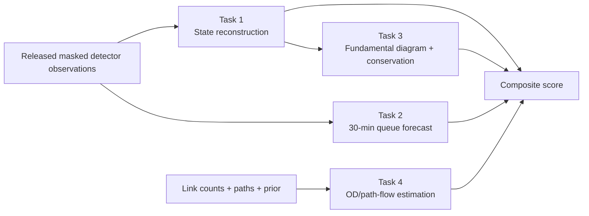
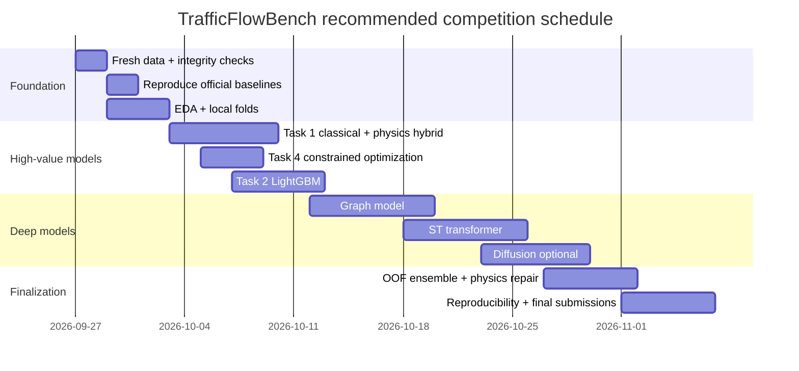
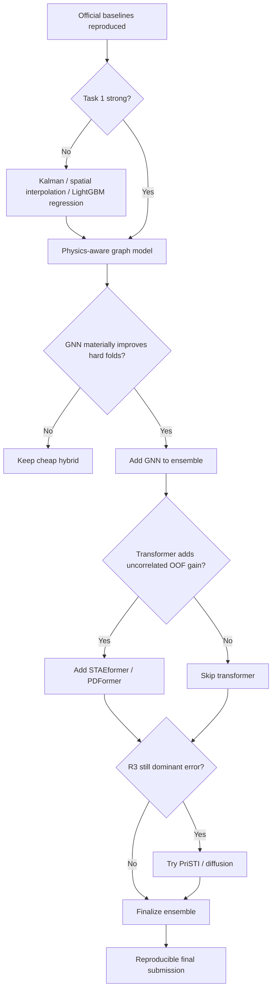

# Deep Research Report: 2026 IEEE Big Data TrafficFlowBench Kaggle Competition

## Executive summary

The **2026 IEEE Big Data TrafficFlowBench** is unusually interesting because it is not a conventional single-target forecasting competition. It is a four-task benchmark that jointly rewards **state reconstruction, queue forecasting, physical consistency, and origin–destination/path-flow estimation**. The official composite is

\[
S_{\text{total}}
=
0.35S_{\text{state}}
+0.30S_{\text{queue}}
+0.15S_{\text{physics}}
+0.20S_{\text{ODME}}.
\]

That structure changes the optimal competition strategy. A model with slightly worse cellwise RMSE but substantially better conservation can outperform a statistically smoother reconstruction, because the same Task 1 predictions also determine Task 3. In effect, **Task 1 + Task 3 account for 50% of the total score**, making physically coherent reconstruction the highest-leverage modeling area. citeturn21search0turn21search4 fileciteturn8file0L1-L2

There is also an important current-data caveat. The organizers **rebuilt the released data on September 11, 2026**, after identifying two routes through which some Task 2 answers could be inferred from an earlier release. Validation and private months were regenerated from new random seeds. Scores from before the rebuild remain visible but are not comparable with current scores and are not award-eligible. Anyone working from a download or cache made before the rebuild should discard it and redownload the competition data. citeturn23search9

The benchmark uses **synthetic traffic generated by a calibrated traffic-flow model**, rather than copied detector records. The calibration draws on real freeway characteristics—free-flow speed, capacity, jam density, detector availability, measurement noise, and demand patterns—but the released calendar is synthetic and corresponds to no real historical period. Consequently, a direct weather/event join to the nominal 2030–2031 dates is not meaningful; external data is better used for pretraining or methodological priors than as a timestamp lookup. fileciteturn4file0L1-L2

The release covers **ten directional freeway panels grouped into five corridor families**, at five-minute resolution, with nine months of labeled/unmasked training observations, one validation month used for the visible leaderboard, and a separate private month for final ranking. The synthetic dates are June 1, 2030–February 28, 2031 for train; March 2031 for validation; and April 2031 for private. The validation and private months were generated independently and contain different incident schedules—five incidents versus seven—so aggressively tuning to the public leaderboard is particularly risky. fileciteturn4file0L1-L2

The organizer's current reference baselines are stronger than a trivial zero model but leave substantial headroom: **0.6929 state, 0.3017 queue, 0.3549 physics, 0.8359 ODME, and 0.5534 composite**. A nominal perfect state/queue/OD answer reaches only 0.9945 composite because measurement noise places the practical Task 3 ceiling below one. fileciteturn7file0L1-L2 A recently published community Kaggle notebook, **"[0.809 LB TOP 50] Open-Sourcing Physics Pipeline,"** reports a public score of **0.80939** and a 45m50s notebook runtime; it is useful as evidence that a strong engineered/physics-aware pipeline is competitive, but it is community code rather than an organizer baseline. citeturn21search16turn21search19

My recommended competition strategy is therefore:

| Priority | Workstream | Why |
|---|---|---|
| **Highest** | Task 1 graph/temporal reconstruction + conservative physics-aware postprocessing | Directly influences **50%** of composite via Tasks 1 and 3. |
| **High** | Task 2 feature-engineered LightGBM, then GNN/ST transformer | Largest obvious gap from organizer baseline; short 30-minute horizon is well suited to propagation features. |
| **High, low cost** | Task 4 regularized constrained optimization | Organizer NNLS baseline is already 0.8359; likely relatively cheap gains from better regularization and count weighting. |
| **Medium** | GNN multi-task model | Natural fit to directed freeway topology and queue propagation. |
| **Medium** | STAEformer/PDFormer-style transformer | Potential upside on incident propagation but higher tuning risk. |
| **Exploratory** | PriSTI/CSDI/DiffSTG diffusion | Very attractive for R3 50%-mask imputation and uncertainty, but expensive and poorly aligned with deterministic scoring unless carefully constrained. |
| **Final** | Out-of-fold blending + physics repair + reproducible submission packaging | Most reliable final increment and essential under competition reproducibility rules. |

As of **September 27, 2026**, the IEEE Big Data Cup page lists **November 6, 2026** as the final date, leaving roughly 40 calendar days. citeturn21search11 Given that horizon, I would **not** begin with diffusion or a very large transformer. I would first reproduce all official scorers, build a leakage-safe local benchmark, get a strong LightGBM/Kalman/graph baseline, add conservation-aware reconstruction, solve ODME well, and only then invest in high-capacity architectures.

## Competition design, datasets, metrics, and leaderboard rules

The conceptual objective is to reconstruct and explain a traffic system rather than optimize one point-error metric. The four tasks interact as follows. Task 1 restores missing speed and flow; Task 3 assesses whether those restored values obey traffic-flow physics; Task 2 forecasts where queues propagate over the next 30 minutes; and Task 4 infers latent path demand from observed link counts and a weak prior. The official repository explicitly emphasizes that Tasks 1 and 3 are the same submission judged from statistical and physical perspectives. fileciteturn2file0L1-L2



**Spatial coverage.** The five corridor families and ten directional panels are explicitly enumerated by the release configuration. fileciteturn11file0L1-L2

| Corridor family | Directional panels | Freeway |
|---|---|---|
| `D7_I10` | `D7_I10_E`, `D7_I10_W` | I-10 |
| `D7_I210` | `D7_I210_E`, `D7_I210_W` | I-210 |
| `D7_I405` | `D7_I405_N`, `D7_I405_S` | I-405 |
| `D12_I5` | `D12_I5_N`, `D12_I5_S` | I-5 |
| `D12_I405` | `D12_I405_N`, `D12_I405_S` | I-405 |

`D12_I405_N` and `D12_I405_S` are excluded from **Task 2 only**; all ten panels remain part of Tasks 1, 3, and 4. fileciteturn8file0L1-L2

**Temporal coverage and sample scale.** The dataset has five-minute granularity, hence 288 time positions per complete day. The exact raw row count depends on the number of stations/links in each panel and is not given as a single normative total in the public documentation; it should therefore be computed directly after downloading rather than inferred from a stale notebook. The known temporal dimensions are: fileciteturn4file0L1-L2

| Split | Synthetic date range | Days | Five-minute positions per station/link | Truth exposure |
|---|---:|---:|---:|---|
| Train | 2030-06-01 – 2031-02-28 | 273 | **78,624** | Unmasked + masked observations |
| Validation | March 2031 | 31 | **8,928** | Masked only |
| Private | April 2031 | 30 | **8,640** | Masked only |

These dates should **not** be interpreted as real future dates. They are synthetic tokens. The validation and private months have separately generated demand and incident scenarios. fileciteturn4file0L1-L2

For Task 2, there are five `queue_onset` and five `queue_ongoing` windows per eligible corridor and split. Since eight directional panels participate in Task 2, that gives **80 official queue windows per split**, each requiring six future five-minute steps, although the number of link-time prediction rows depends on panel link counts. Origins within a panel/split/condition are separated by at least six hours. fileciteturn8file0L1-L2

**File layout.** The release expands to roughly **13 GB** according to the official repository and is organized under a single `kaggle_public/` root. fileciteturn3file0L1-L2 The main assets are: fileciteturn4file0L1-L2

| File / directory | Role |
|---|---|
| `config/synthetic_release_v1.json` | Calendar/scenario contract and Task 2 window policy |
| `config/corridors.json` | Five families / ten directional panels |
| `corridors/<PANEL>/network/links.csv` | Link length, lanes, free-flow speed, capacity |
| `fd_parameters.csv` | Fundamental-diagram parameters and lane counts |
| `lwr_mainline_topology.csv` | Directed mainline adjacency used for conservation |
| `ramp_attachment_map.csv` | Ramp-to-mainline topology |
| `path_set.csv` | OD paths with origin/destination zones |
| `path_link_incidence.csv` | Path-to-link incidence matrix \(A\) |
| `mainline_states/` | Train-only unmasked observations |
| `mainline_states_masked/` | Task 1 masked observations, R1/R2/R3 |
| `ramp_states/` | On/off-ramp flow observations |
| `task1/.../sample_submission_state.csv` | Required Task 1 cells |
| `task2/.../window_index.csv` | Forecast-window metadata |
| `task2/.../window_history.parquet` | 60-minute Task 2 history |
| `task2/.../sample_submission_queue.csv` | Six-step binary queue targets |
| `task4/.../synthetic_link_counts.csv` | ODME count observations |
| `task4/.../synthetic_weak_prior.csv` | Weak path-flow prior |
| `task4/.../sample_submission_path_flow.csv` | Required Task 4 path flows |
| root `sample_submission.csv`, `submission_key.csv` | Unified Kaggle upload schema and row mapping |

The state data exposes five-minute **speed, flow and occupancy**, together with station/link identity and quality information including `pct_observed`. Only speed and flow are directly scored; occupancy can still be useful as an input feature. Density is derived by the evaluator, not submitted. fileciteturn8file0L1-L2

The natural per-task submission schemas are: fileciteturn6file0L1-L2

```text
Task 1
panel,timestamp,station_id,link_id,mask_regime,speed_kmh,flow_vph

Task 2
window_id,timestamp,link_id,queue_pred

Task 4
panel,departure_time,path_id,origin_zone,destination_zone,path_flow
```

Task 3 deliberately has **no independent predictions**; it reads Task 1 speed/flow values. The final Kaggle file is assembled using `submission_key.csv`. fileciteturn6file0L1-L2

**Evaluation.** The exact current scoring contract is in the official repository. fileciteturn8file0L1-L2

| Component | Definition | Weight in total |
|---|---|---:|
| State reconstruction | \(S_v=\max(0,1-\mathrm{RMSE}_v/25)\); \(S_q=\max(0,1-\mathrm{RMSE}_{q/\text{lane}}/600)\); \(S_{\text{state}}=0.54S_v+0.46S_q\), averaged across R1/R2/R3 | **0.35** |
| Queue forecast | Space-time IoU of binary queued link/time cells | **0.30** |
| Physical consistency | \(S_{\text{physics}}=\frac13S_{FD}+\frac23S_{LWR}\) | **0.15** |
| OD/path flow | \(0.45S_{od}+0.25S_{link}+0.15S_{dev}+0.15S_{attr}\) | **0.20** |

Task 1's flow RMSE is explicitly converted to **per-lane flow** before scoring. That matters: train and report models in physically normalized units, not only total `flow_vph`. Mask rates are R1 = 20%, R2 = 30%, and R3 = 50%. fileciteturn8file0L1-L2

For Task 2, a link is considered queued when

\[
v \leq 0.60v_{\text{free}}.
\]

The ground-truth label is derived from the hidden underlying traffic state, rather than the noisy detector observation, which means simply thresholding an observed speed is not a perfect training label. The forecast uses only the preceding 60 minutes and predicts `T+5,...,T+30`. fileciteturn8file0L1-L2

Task 3 evaluates the fundamental diagram and a five-minute conservation relationship,

\[
N_{t+\Delta t}-N_t
=
\Delta t
(q_{\text{in}}+r_{\text{on}}-q_{\text{out}}-r_{\text{off}}).
\]

The LWR term receives twice the weight of the fundamental-diagram term inside Task 3. The organizer's true boundary flows are hidden, so the official repository warns that local Task 3 scoring is not representative—the fallback estimate makes the conservation term effectively uninformative. Use Task 1 OOF accuracy plus your own conservation diagnostics rather than optimizing the reported local Task 3 number. fileciteturn8file0L1-L2

Task 4 evaluates not just count fit \(A\hat f\approx c\), but closeness to the hidden path-flow reference, deviation from the weak prior, and the destination-attraction distribution. That is why an unconstrained exact count fit can be worse than a regularized solution. fileciteturn8file0L1-L2

**Leaderboard and competition rules.** Teams may have at most four members. One CSV is uploaded per submission. Incomplete or invalid task sections score zero under the current Kaggle rules; malformed files, blank cells, duplicate row IDs, or unknown IDs can be rejected. The visible public leaderboard and final private leaderboard are different synthetic months, so public-LB optimization is particularly dangerous. citeturn23search9

The numeric daily-submission cap and number of selectable final submissions are controlled by Kaggle competition settings; the indexed rules do not state fixed numbers, so those two values should be read directly from the live competition interface rather than assumed. citeturn23search9

The current rules allow public external datasets, pretrained models, software, AutoML tools and APIs when appropriately licensed and reasonably accessible, but finalists must disclose external dependencies and reproduce their selected submission. citeturn23search9

Useful competition links:

- [Competition overview](https://www.kaggle.com/competitions/2026-ieee-big-data-traffic-flow-bench/overview) citeturn21search0
- [Data page](https://www.kaggle.com/competitions/2026-ieee-big-data-traffic-flow-bench/data) citeturn21search8
- [Rules](https://www.kaggle.com/competitions/2026-ieee-big-data-traffic-flow-bench/rules) citeturn23search9
- [Official TrafficFlowBench repository](https://github.com/jacky850/trafficflowbench-public) fileciteturn3file0L1-L2

## Data quality, preprocessing, and feature engineering

TrafficFlowBench contains three distinct kinds of "missingness," and conflating them is one of the easiest ways to build a weak or leaky pipeline.

First, there is **detector-quality missingness/degradation**. Every mainline and ramp cell has a `pct_observed` quality variable. The release defines `pct_observed < 100` as imputed/degraded and makes cells score-eligible only when `pct_observed >= 75` and the required variables are non-null. Roughly **76%** of mainline and ramp observations are eligible. Ineligible observations remain in the release because unreliable sensors are part of the intended problem. fileciteturn4file0L1-L2

Second, Task 1 contains **deliberate benchmark masks** at R1/R2/R3 rates of 20%, 30%, and 50%. These are the targets to reconstruct. fileciteturn8file0L1-L2

Third, the Task 2 design contains deliberate future masking/embargo regions around forecast windows. The official documentation warns that not every null in a masked state file is therefore a Task 1 target; the submission template, rather than "all null cells," defines the scored Task 1 row set. fileciteturn2file0L1-L2

A particularly important quality rule applies to ramps: **missing ramp flow does not mean zero flow**. The evaluator treats unavailable ramp measurements as unavailable evidence. Zero-filling such observations can create false vehicle conservation and damage Task 3. fileciteturn4file0L1-L2

The data also contains realistic measurement noise and explicit traffic incidents. Validation contains five independently generated incidents and private contains seven. This is not a conventional random missing-at-random dataset: the hardest cells are likely near queue formation, dissipation and shock propagation, exactly where simple interpolation is least reliable. citeturn21search8

I would implement preprocessing in this order:

**Preserve masks as first-class inputs.** Store separate binary/continuous channels for `observed`, `pct_observed`, `score_eligible`, deliberate R1/R2/R3 mask, ramp availability and Task 2 embargo. Never silently replace all missing values with zero.

**Normalize in traffic-physical coordinates.** In addition to raw units, create

\[
\tilde v = v/v_f,\qquad
\tilde q=q/\text{lanes},\qquad
q/c,\qquad
k \approx q/\max(v,\epsilon).
\]

Speed/free-speed and flow/capacity ratios generalize better between heterogeneous links than raw speed or flow. Keep raw channels as well because metric errors are ultimately evaluated in km/h and veh/h/lane. Network fields such as lanes, free-flow speed, capacity, length and FD parameters are explicitly released. fileciteturn4file0L1-L2

**Fit all statistical scalers on training folds only.** For deep networks, a good initial choice is per-panel robust or standard scaling, optionally followed by link embeddings. A per-link normalization can improve fit but risks removing cross-link physical meaning; feeding both normalized and physical ratios is safer.

**Train Task 1 with artificial masks matching the competition distribution.** Start from unmasked train observations, generate R1-, R2- and R3-style masks, and predict held-out eligible cells. Include contiguous sensor-failure blocks as an extra augmentation even if the official mask mechanism is mostly dispersed; this makes models more robust to real `pct_observed` failures.

**Do not build Task 2 labels from future validation observations.** The official labels are withheld. For local development, construct **proxy labels** from training observations using the 0.60-free-speed threshold, but recognize that these labels contain detector noise whereas official labels are generated from the underlying synthetic state. fileciteturn8file0L1-L2

**Check the September rebuild fingerprint.** Store the data-version/hash in experiment metadata. Do not reuse pre-September-11 features, prediction caches or public-LB conclusions; the current competition rules explicitly state that the evaluation months were regenerated. citeturn23search9

The highest-value feature set is likely a blend of temporal, spatial and physics variables.

| Feature group | Suggested features | Best use |
|---|---|---|
| Calendar | minute-of-day sin/cos, weekday embedding, weekend indicator | Task 1 historical state |
| Short temporal lags | 5/10/15/30/45/60-minute speed, flow and occupancy lags | Tasks 1, 2 |
| Trend/acceleration | \(\Delta v,\Delta q\), rolling slopes, rolling min/max/std | Queue onset |
| Recurrent patterns | same five-minute slot previous day; weekday-time historical mean | Task 1 |
| Relative traffic state | \(v/v_f,q/c,q/\text{lane}\), estimated density | All traffic models |
| Upstream/downstream | neighbor speed/flow, 1–3 hop graph aggregations | Queue propagation |
| Ramp effects | on/off-ramp flow, availability mask, attachment location | Tasks 1, 3 |
| Bottleneck structure | lane changes, capacity ratios, link length, downstream capacity | Tasks 1, 2 |
| Queue-front features | consecutive low-speed upstream links, spatial gradient \(\nabla v\), change in queue length | Task 2 |
| Quality | `pct_observed`, missing-run length, neighbor data availability | Task 1 |
| Learned identity | panel/link/station embeddings | Deep models |

For **queue onset**, pay special attention to traffic-wave indicators rather than absolute speed alone. A link whose speed remains above 0.60 free-flow but is falling rapidly while its downstream neighbor is already near capacity is a better onset signal than current queue persistence. This is where graph-based models should have their largest advantage over the organizer persistence baseline.

External weather and event features deserve a clear **do-not-default-to-them** recommendation. The release explicitly says no real detector record appears in it and the released calendar matches no real period. fileciteturn4file0L1-L2 The rules further say external datasets may help build methods but cannot contain the hidden answer key. citeturn23search9 Therefore:

- joining historical weather for "March 2031" would attach weather to a fictional scenario and is conceptually wrong;
- joining sports/holiday/event calendars by those synthetic dates is similarly unjustified;
- useful external information would instead be **pretraining data** from other traffic networks, generic freeway geometry priors, generic meteorological sensitivity learned elsewhere, or pretrained time-series representations.

My default competition solution would use **no timestamp-matched external weather/events data** unless the organizers later release synthetic exogenous variables.

## Model-family analysis and recommended architectures

A winning system should probably not be a single architecture. Different tasks favor different inductive biases, and the competition's physics term makes hybrid statistical/physical modeling unusually valuable.

**Classical time-series, state-space, and boosted-tree models.** The organizer already provides a historical weekday/time-of-day Task 1 model and optional structural Kalman-filter teaching code. The Task 1 baseline intentionally ignores same-day spatial information, which leaves obvious room for a Kalman smoother or graph-conditioned state-space model. fileciteturn7file0L1-L2

For Task 2, a carefully engineered **LightGBM** classifier should be the first serious baseline. LightGBM's original method was designed for efficient gradient-boosted decision trees on large tabular datasets, making it a good match to millions of derived lag/neighbor rows. citeturn18search0 Recent non-transformer neural forecasting baselines such as **N-HiTS** provide another efficient temporal benchmark through hierarchical interpolation and multi-rate sampling. citeturn17search0 TiDE is another comparatively simple dense encoder with covariate support. citeturn17search1turn17search4

Recommended starting hyperparameters:

| Classical model | Starting search |
|---|---|
| Kalman/state-space Task 1 | local-level + slope; observation variance conditioned on `pct_observed`; process-noise multiplier 0.1–10×; optionally spatially coupled states |
| LightGBM Task 2 | `learning_rate=0.02–0.08`, `num_leaves=31–255`, `max_depth=6–12`, `min_data_in_leaf=200–5000`, `feature_fraction=0.7–1`, `bagging_fraction=0.7–1`, 500–3000 trees with early stopping |
| N-HiTS | lookback 12–72 depending task, 2–3 stacks, hidden width 256–512, dropout 0–0.2, Adam/AdamW \(10^{-4}\)–\(10^{-3}\) |
| Task 4 NNLS | \(\lambda\) prior penalty log-grid \(10^{-4}\) to \(10^{1}\); optional link-count reliability weights |

The **strengths** are speed, interpretability, easy cross-validation, stable extrapolation and low hardware cost. The main **weakness** is that linkwise state-space models and tabular GBDTs do not automatically discover queue propagation or conservation; spatial features must be explicitly engineered.

The organizer Task 4 baseline is particularly important: it solves

\[
\min_{f\ge0}
\|Af-c\|^2 + \lambda\|f-b\|^2
\]

with \(\lambda=0.05\). Its current ODME score is already 0.8359. fileciteturn7file0L1-L2 This strongly suggests that Task 4 should initially remain an optimization problem rather than become a deep-learning project. Tune per-panel regularization, count reliability and attraction constraints first.

**Graph neural networks.** TrafficFlowBench supplies exactly the structure GNNs need: directed mainline topology, ramp attachments, link geometry, capacities and FD parameters. fileciteturn4file0L1-L2

Three useful architectural references span the evolution of traffic GNNs:

- **Graph WaveNet** learns an adaptive dependency matrix while using dilated temporal convolutions, allowing the model to supplement an explicit road graph with latent correlations. citeturn15search3
- **AGCRN** learns node-specific parameters and a data-adaptive graph rather than relying solely on predefined adjacency. citeturn16search6
- **MegaCRN** adds a meta-graph learner intended to adapt to heterogeneous/non-stationary traffic conditions, including incident-like situations. citeturn16search5turn16search21

For TrafficFlowBench I would start with a **directed Graph WaveNet/MegaCRN hybrid**, where the official topology is one adjacency and a learned low-rank adjacency is a second channel. This limits the risk of allowing a fully adaptive graph to learn correlations that contradict road direction.

Suggested hyperparameters:

| Parameter | Search range |
|---|---|
| History | Task 2: exactly available 12 five-minute observations; Task 1: 24–72 initially |
| Hidden width | 32, 64, 96, 128 |
| GNN blocks | 2–4 |
| Graph diffusion hops | 1–3 |
| Learned node embedding | 8–32 |
| Temporal kernel | 2–3 |
| Dropout | 0.10–0.30 |
| AdamW LR | \(3\times10^{-4}\)–\(2\times10^{-3}\) |
| Weight decay | \(10^{-5}\)–\(10^{-3}\) |
| Gradient clip | 1–5 |
| Batch unit | panel/day slices for Task 1; complete windows for Task 2 |

For Task 1, train it as a **masked graph reconstruction** model predicting speed and flow jointly. For Task 2, output six link-level logits in one shot rather than recursively forecasting six times; recursive prediction magnifies errors exactly around queue-front discontinuities.

The expected **strength** is propagation modeling. Queue spillback and shock waves are inherently spatial, and a downstream state often predicts upstream congestion better than another 5-minute lag of the same sensor. The main **weaknesses** are over-smoothing and adaptive-graph instability. A purely learned graph may also invent strong statistical edges between links that are not physically connected.

**Spatio-temporal transformers.** Transformers become attractive once a strong GNN baseline is established, particularly because incident traffic can require longer-range and state-dependent spatial relationships.

**PDFormer** was designed specifically for traffic and explicitly models dynamic short-/long-range dependencies together with propagation delay. That propagation-delay mechanism aligns exceptionally well with Task 2's queue-front problem. citeturn15search1turn15search9 **STAEformer** demonstrates that carefully constructed spatio-temporal adaptive embeddings can make a relatively vanilla Transformer highly competitive on traffic forecasting benchmarks. citeturn15search0turn15search4

Generic time-series architectures provide useful alternative backbones. **PatchTST** reduces attention cost by tokenizing subsequences into patches and sharing a channel-independent Transformer. citeturn14search0turn14search8 **iTransformer** instead treats individual variates as tokens to learn cross-variable dependencies. citeturn14search1turn14search5

My first transformer configuration would be closer to **STAEformer/PDFormer** than to a generic PatchTST, because TrafficFlowBench provides an actual transport graph.

Suggested search space:

| Hyperparameter | Starting range |
|---|---|
| `d_model` | 64–256 |
| Layers | 2–6 |
| Attention heads | 4–8 |
| FFN ratio | 2–4× |
| Dropout | 0.05–0.20 |
| Temporal positional encoding | 5-min position + time-of-day + weekday |
| Spatial encoding | link ID + topology distance + directional graph mask |
| Task 2 lookback | 12 steps |
| Task 1 lookback/context | 36–144 steps initially |
| Patch length if PatchTST | 3–6 samples |
| Patch stride | 1–3 |
| AdamW LR | \(10^{-4}\)–\(10^{-3}\) |
| Warmup | 5–10% of steps |
| Label smoothing for queue | 0–0.05 |

The key **strengths** are dynamic long-range dependence and flexible incident representations. The key **risks** are small effective incident sample size, validation overfitting, and compute. There are only five public-validation incidents and seven private incidents, so high-capacity attention models can easily learn the wrong incident regime. citeturn21search8

A very recent optional benchmark is Google's **TimesFM-3**, announced in August 2026 as a 330M-parameter multivariate time-series foundation model trained on more than a trillion time points. citeturn15search2 I would use it only as a **zero-shot/feature benchmark**, not as the core solution: it does not natively encode the organizer's freeway topology or Task 3 conservation constraints.

**Diffusion models.** Diffusion is particularly compelling for Task 1 because the task is literally conditional spatio-temporal imputation under missingness levels as high as 50%.

**CSDI** formulates time-series imputation as conditional score-based diffusion and trains by self-supervised masking, making its learning setup conceptually close to TrafficFlowBench Task 1. citeturn14search2 **PriSTI** extends conditional diffusion specifically to spatio-temporal imputation and explicitly incorporates geographic/spatial relationships; its authors evaluate scenarios including high missing rates and sensor failure. citeturn14search3turn14search7 This is probably the most directly relevant research architecture for R3 reconstruction.

For probabilistic forecasting, **TimeGrad** introduced autoregressive diffusion for multivariate probabilistic time series. citeturn22academia28 **DiffSTG** adapts denoising diffusion to spatio-temporal graphs and reports improvements in probabilistic and point forecasting metrics over comparator models on three real-world datasets. citeturn22academia29

Recommended initial diffusion settings:

| Hyperparameter | Starting range |
|---|---|
| Training diffusion steps | 50–100 |
| Fast inference steps | 10–25 after validating a deterministic sampler |
| Hidden channels | 64–128 |
| Residual layers | 4–8 |
| Time embedding | 64–128 |
| Spatial graph hops | 2–3 |
| Conditioning | observed speed/flow/occupancy + masks + `pct_observed` + graph |
| Training masks | balanced/curriculum mixture of R1/R2/R3 |
| Samples at inference | 4–16 initially |
| Point output | posterior mean/median chosen by OOF RMSE |

The principal **strength** is its ability to represent multiple plausible missing traffic states rather than collapsing immediately to an average. That can be valuable across a large queue-shaped hole.

The major **weakness** is competition alignment. Task 1 ultimately rewards deterministic RMSE, while Task 3 rewards conservation. A diffusion sample can be statistically plausible yet violate vehicle balance. Multiple denoising steps also multiply inference cost. Therefore I would only pursue diffusion after the graph model is competitive, and I would apply a light physics projection or include conservation penalties in the denoising objective.

Across all four families, I recommend a shared physics-aware loss for state reconstruction:

\[
\mathcal L =
w_v\,\mathrm{MSE}(\hat v,v)
+
w_q\,\mathrm{MSE}(\hat q/\ell,q/\ell)
+
\lambda_{\text{LWR}}\mathcal L_{\text{conservation}}
+
\lambda_{\text{FD}}\mathcal L_{\text{FD}}
\]

with the first two terms scaled to approximate the competition's 25 km/h and 600 veh/h/lane normalization. Start with small physics coefficients—e.g. \(\lambda_{\text{LWR}}\in[0.01,0.2]\)—rather than forcing exact conservation through noisy measurements. The organizer itself notes that measurement noise prevents even a perfect underlying reconstruction from receiving a perfect Task 3 score. fileciteturn7file0L1-L2

## Validation, hyperparameter tuning, ensembling, and diagnostics

The central validation challenge is that only Task 1 has an authoritative local target that faithfully reproduces the leaderboard evaluation. Task 2 labels are withheld, Task 3 needs hidden organizer boundary flows, and Task 4's locally constructible reference is useful mainly for checking solver behavior rather than reproducing private rank. fileciteturn4file0L1-L2

I would therefore build a **nested temporal simulation benchmark** from the nine-month training period.

For Task 1, use expanding or blocked temporal folds rather than random rows. One reasonable starting design is four folds with entire multi-week or monthly blocks held out. Within each holdout block, regenerate R1/R2/R3 masks from only eligible cells. Every scaler, historical profile and learned per-link statistic must be fitted on the fold's training portion.

A stronger validation scheme should also stratify by traffic state:

- ordinary uncongested days;
- recurrent rush-hour congestion;
- strong congestion/incident-like days;
- high sensor-missingness days.

The model that has the lowest average RMSE on easy free-flow days is not necessarily the one that will survive the seven private incidents.

Task 2 should use **window-level folds**, never individual rows. Construct 60-minute history/30-minute horizon windows from training traffic, deliberately oversampling transitions into congestion. Keep all rows from one window in the same fold. Critically, no feature may use a timestamp later than forecast origin \(T\).

A useful proxy hierarchy for Task 2 is:

\[
\text{proxy IoU}
\rightarrow
\text{IoU by onset/ongoing}
\rightarrow
\text{IoU by horizon}
\rightarrow
\text{queue-front displacement error}.
\]

Optimize all four, not only aggregate classification AUC. A model can have excellent AUC while producing a spatially fragmented binary mask with poor IoU.

For Task 3, compute your own conservation diagnostics but **do not tune to the official local `score_task3.py` number**. The repository explicitly warns that hidden organizer boundary flows are unavailable and its public fallback can reduce the LWR component to effectively zero even for a perfect answer. fileciteturn2file0L1-L2 Instead, compare the change in local conservation residual against the change in Task 1 RMSE; reject physics postprocessing that obtains conservation only by destroying reconstruction accuracy.

For Task 4, perform robustness tests by withholding a subset of link counts and measuring whether fitted path flows reproduce the held-out counts. This is a better hyperparameter signal than minimizing residual on every count used to solve the inverse problem.

**Leakage checklist.**

1. Use only the September 11 rebuild or later; old caches are contaminated from a competition-validity perspective. citeturn23search9
2. Never train a transform/scaler on validation/private values that would not exist in production.
3. For Task 2, prohibit any timestamp \(>T\), including rolling-window implementations that center a window.
4. Distinguish Task 1 target masks from generic nulls and Task 2 embargo blanks.
5. Do not replace unavailable ramps by zero. fileciteturn4file0L1-L2
6. Do not use the synthetic 2030–2031 timestamp to query real historical weather/events.
7. Keep all observations belonging to the same day/window/event together when splitting.
8. Save the exact `submission_key.csv` and data-version hash beside every experiment.

For hyperparameter optimization, the public leaderboard should be treated as a **final generalization probe**, not a validation set. Validation and private were independently generated with different incident schedules, and the rules were explicitly designed to discourage public-LB fitting. fileciteturn4file0L1-L2

A practical tuning budget would be approximately 40–80 trials for LightGBM, 20–40 configurations for GNNs, 15–30 for transformers, and only 10–20 carefully selected diffusion configurations. Use aggressive early stopping and a low-fidelity stage on one or two panels before training all ten.

For deep models, run at least **three seeds** for finalist configurations. If model-order variation is larger than the improvement over the incumbent model, the purported gain is not robust enough to trust on the private month.

**Ensembling should be task-specific.**

For Task 1, blend a low-variance historical/Kalman prediction with GNN and transformer/diffusion predictions:

\[
\hat y
=
w_1\hat y_{\text{state-space}}
+
w_2\hat y_{\text{GNN}}
+
w_3\hat y_{\text{Transformer}}.
\]

Optimize weights on concatenated OOF predictions, separately for speed and flow if necessary, while monitoring conservation. Because averaging often smooths congestion, do not assume a lower RMSE blend automatically improves Task 3.

For Task 2, blend **probabilities before thresholding**, for example LightGBM + GNN + PDFormer. Optimize the binary threshold directly for OOF IoU rather than accepting 0.5. Consider horizon-dependent thresholds because onset predictions at +30 minutes are substantially less certain than +5 minutes.

A mild graph-aware postprocessor can remove isolated one-link/one-timestep queue predictions or extend contiguous queues when adjacent probabilities are near threshold, but every such rule should be tuned on complete OOF windows.

For Task 4, ensemble regularization settings through convex combinations of non-negative path-flow solutions. A blend of a strong-prior solution and a count-fitting solution can often trade \(S_{od}/S_{dev}\) against \(S_{link}\) more gracefully than a single extreme \(\lambda\).

The following diagnostics should be generated for **every serious experiment**.

| Plot / diagnostic | What it reveals |
|---|---|
| RMSE by panel × R1/R2/R3 heatmap | Whether the model actually handles 50% masking |
| Speed RMSE by time of day | Rush-hour failure |
| Flow-per-lane RMSE by capacity bin | Capacity-scale bias |
| Error vs `pct_observed` | Sensor-quality sensitivity |
| Error vs missing-run length | Failure under sensor outages |
| Truth/prediction spatial-time heatmaps | Whether queues are reconstructed rather than smoothed |
| Speed-flow fundamental-diagram scatter | Impossible reconstructed states |
| Conservation-residual heatmap by link/time | Where vehicles appear/disappear numerically |
| Residual histogram by link | Persistent sensor/model bias |
| Queue IoU by +5/+10/.../+30 min | Error growth with horizon |
| IoU by onset vs ongoing | Whether model merely persists existing queues |
| Queue-front distance error | Spatial propagation quality |
| Probability calibration/reliability plot | Whether thresholds can be tuned meaningfully |
| IoU-vs-threshold curve | Optimal Task 2 operating point |
| \(A\hat f-c\) residual by link | ODME count fit |
| Prior versus fitted path-flow scatter | Excessive OD deviation |
| Destination attraction bars | Task 4's \(S_{attr}\) behavior |
| OOF score versus public score | Public-LB overfitting indicator |

The most valuable single visualization is probably a **space-time diagram** with freeway links ordered along the corridor on the vertical axis and time on the horizontal axis, showing true/released/predicted normalized speed. Traffic shock waves appear as diagonal structures; good models should reconstruct their slope rather than merely fill missing cells smoothly.

## Compute, training engineering, and inference optimization

The roughly 13-GB expanded release is large enough that data engineering matters, but the physical graph itself is small compared with vision or language workloads. fileciteturn3file0L1-L2 Most wasted compute will therefore come from repeatedly parsing Parquet/CSV and rebuilding features rather than from graph-message passing alone.

A recommended storage architecture is:

```text
raw immutable release
        |
        v
validated parquet/index metadata
        |
        +--> static graph tensors
        |
        +--> temporal feature store
        |
        +--> mask/window index
        |
        v
fold-specific train datasets
        |
        v
models / OOF predictions
        |
        v
ensemble + physics repair
        |
        v
submission.csv
```

Cache only transformations that are independent of fold labels. Per-link historical means, scalers and target-derived aggregations must remain fold-specific.

The following are **planning estimates, not organizer benchmark measurements**. Actual figures depend heavily on station/link counts, sequence construction, GPU architecture and framework implementation.

| Model | Reasonable development machine | Approximate per-serious-run planning budget | Main bottleneck |
|---|---|---:|---|
| Historical/Kalman | 8–16 CPU cores, 32–64 GB RAM | minutes–1 h | IO/grouping |
| LightGBM | 16–32 CPU cores, 64 GB RAM | ~0.5–3 h | feature matrix |
| Task 4 NNLS | 8–16 CPU cores, 32 GB | minutes | sparse linear algebra |
| Graph WaveNet/AGCRN/MegaCRN | 1× 16–24 GB GPU | ~2–8 h | sequence generation |
| STAEformer/PDFormer | 1× 24–48 GB GPU | ~4–16 h | attention + folds |
| PriSTI/CSDI | 1× 24–48 GB minimum; 48–80 GB comfortable for large batches | ~8–30 h | iterative diffusion |
| Multi-model final ensemble | CPU + one GPU | hours | repeated full-split inference |

These ranges should be replaced with measurements after a 5–10% pilot. A current community Kaggle notebook producing a complete competition pipeline reports a runtime of **45m50s**, which demonstrates that competitive submission generation need not require a multi-GPU cluster, although that notebook's hardware and architecture are not a controlled benchmark for the models above. citeturn21search19

For neural training, use mixed precision, pinned-memory loaders, precomputed graph adjacency, contiguous `(time,node,feature)` tensors, gradient accumulation only where needed, and window sampling rather than materializing every overlapping training tensor to disk.

Task 1 should be batched primarily by **panel × contiguous time block**. That preserves graph locality and minimizes repeated adjacency processing.

Task 2 is much smaller at inference: each request contains only 60 minutes of history and a single corridor graph. Batch the six future horizons in one forward pass.

Task 4 should never require GPU serving if solved with sparse constrained optimization.

For competition inference, optimize **throughput and reproducibility**, not millisecond latency. For a hypothetical traffic-management deployment, however, the priorities differ:

| Deployment path | Recommended model |
|---|---|
| Lowest latency / CPU only | LightGBM |
| Strong spatial model, modest latency | Small Graph WaveNet / AGCRN |
| Best rich context if GPU available | STAEformer / PDFormer |
| Probabilistic uncertainty, offline | DiffSTG/PriSTI |
| Strict real-time requirement | Distilled GNN or LightGBM ensemble surrogate |

I would set an internal engineering target of **sub-second Task 2 inference per corridor including feature assembly**, not because Kaggle requires it, but because a 5-minute measurement interval makes substantially slower online inference operationally unnecessary. Precompute static link embeddings and adjacency; update only the twelve dynamic history steps.

For transformer/GNN inference, batch all links and all six horizons, use FP16/BF16 where numerically stable, and benchmark model compilation only after finalizing architecture. For LightGBM, contiguous feature arrays and a single batch prediction are preferable to row-at-a-time serving.

Diffusion requires special treatment. Reduce sampling from 50–100 training diffusion steps to approximately 10–25 inference steps only after confirming that RMSE is not materially degraded. An even better production strategy is to use the diffusion model as a **teacher/ensemble member** and distill its posterior mean into a deterministic GNN.

Submission construction is itself an engineering risk because the competition operates at roughly seven-million-cell scale and the official rules compare reproducibility at that scale. citeturn23search9 Before upload, run invariant checks for:

```text
exact expected submission_id set
no duplicates
no NaNs / infs
queue_pred ∈ {0,1}
speed_kmh finite
flow_vph finite and physically reasonable
path_flow >= 0
exact row order required by sample_submission
data version == current release
model/checkpoint hash recorded
```

The September rebuild makes experiment provenance particularly important.

## Prioritized implementation plan, experiment matrix, and source roadmap

With roughly 40 days from September 27 to the stated November 6 final date, the correct strategy is to front-load robust score improvements and make diffusion optional. citeturn21search11 For one experienced ML engineer, I estimate approximately **180 person-hours for the core program** and another **30–45 hours for serious diffusion experimentation**.



A practical milestone budget is:

| Milestone | Deliverable | Person-hours | Go/no-go criterion |
|---|---|---:|---|
| Fresh-data integrity | Verified September rebuild, schemas, hashes, row counts | **8** | All official scripts run; no stale cache |
| Baseline reproduction | Organizer Task 1/2/4 baselines + scorer tests | **12** | Approximately reproduce documented baseline behavior |
| EDA/local benchmark | Fold generator, mask simulator, diagnostic plots | **16** | Stable OOF score across panels |
| Task 1/3 classical | Historical + structural KF + spatial interpolation + physics repair | **30** | Clear R2/R3 improvement over 0.6929 state baseline |
| Task 4 | Tuned regularized NNLS / constrained solver | **12** | Improvement over 0.8359 proxy/baseline without pathological prior deviation |
| Task 2 LightGBM | Engineered propagation features + threshold optimization | **22** | Large proxy-IoU improvement over persistence |
| GNN | Joint masked reconstruction / queue model | **32** | Meaningful OOF gain on hard/incident-like windows |
| ST transformer | STAEformer/PDFormer variant | **28** | Beats GNN or adds sufficiently uncorrelated errors |
| Ensemble/repro | OOF blend, task packaging, frozen environment | **20** | End-to-end identical rerun |
| Optional diffusion | PriSTI/CSDI or DiffSTG experiment | **30–45** | Retain only if it materially improves R3 or ensemble diversity |

The **core total is about 180 person-hours**. With a two-person team, parallelize Task 1/3 graph modeling and Task 2/4 development rather than having both people independently tune the same architecture.

A compact experiment matrix:

| ID | Model | Task/data | Primary local metric | Expected advantage | Main risk | Priority |
|---|---|---|---|---|---|---|
| E0 | Organizer historical/persistence/NNLS | All | Official/proxy scores | Reproducibility anchor | Weak predictive power | **Mandatory** |
| E1 | Kalman + temporal/spatial interpolation | Task 1 train masks | State score by R1/R2/R3 | Very cheap RMSE gain | Smooths queues | **Very high** |
| E2 | Physics-aware E1 | Tasks 1+3 | State + conservation diagnostics | Targets 50% score block | Physics penalty harms RMSE | **Very high** |
| E3 | LightGBM | Task 2 train proxy windows | IoU onset/ongoing | Fast, strong feature baseline | Proxy-label noise | **Very high** |
| E4 | Tuned NNLS/constrained ODME | Task 4 | link residual + prior/attraction diagnostics | Low-cost improvement | Overfits observed counts | **High** |
| E5 | Graph WaveNet / MegaCRN | Tasks 1,2 | State + proxy IoU | Queue propagation/topology | Oversmoothing | **High** |
| E6 | STAEformer / PDFormer | Tasks 1,2 | State + proxy IoU | Dynamic propagation delays | Incident overfit / compute | **Medium-high** |
| E7 | PriSTI / CSDI | Task 1 | especially R3 state score | Designed for missing ST data | Slow; physics violations | **Medium/optional** |
| E8 | DiffSTG | Task 2 | proxy IoU + calibration | Uncertainty on onset | Expensive; deterministic metric | **Optional** |
| E9 | OOF weighted ensemble | Tasks 1,2,4 | composite proxy | Error diversification | Queue smoothing | **Mandatory late-stage** |
| E10 | Ensemble + minimal physics projection | Tasks 1+3 | state score + LWR proxy | Direct composite leverage | Projection bias | **Final candidate** |

The architecture selection logic is therefore:



The official reference numbers are useful gates. The current baseline table is **0.6929 state / 0.3017 queue / 0.3549 physics / 0.8359 ODME / 0.5534 total**. fileciteturn7file0L1-L2 Since Task 4 is already comparatively strong and Tasks 2/3 leave much larger proportional gaps, I would not spend a week replacing regularized ODME with a deep neural estimator before state and queue models are competitive.

For Kaggle code references, distinguish **organizer code** from **community notebooks**:

| Resource | Status | Link / significance |
|---|---|---|
| TrafficFlowBench official repository | Organizer reference | [GitHub repository](https://github.com/jacky850/trafficflowbench-public) contains schemas, scorers and runnable Task 1/2/4 baselines. fileciteturn3file0L1-L2 |
| Historical-mean Task 1 | Organizer baseline | `src/task1/build_task1_baseline_submission.py`; weekday × time-of-day per link. fileciteturn7file0L1-L2 |
| Structural Kalman filter | Organizer teaching code | `src/task1/baseline_task1_structural_kf.py`. fileciteturn7file0L1-L2 |
| Persistence Task 2 | Organizer baseline | `src/task2/build_task2_persistence_submission.py`. fileciteturn7file0L1-L2 |
| Regularized ODME | Organizer baseline | `src/task4/build_task4_odme_artifacts.py`, \(\lambda=0.05\). fileciteturn7file0L1-L2 |
| `[0.809 LB TOP 50] Open-Sourcing Physics Pipeline` | Community Kaggle notebook | [Notebook](https://www.kaggle.com/code/soukeaizenz/0-809-lb-top-50-open-sourcing-physics-pipeline), current indexed public score 0.80939. citeturn21search16turn21search19 |
| `TFB Task2 LGBM + MU Cache+1` | Community Kaggle code asset | Appears in the current Kaggle Code index and is referenced as an input by the physics-pipeline notebook. citeturn22search0turn22search4 |

For primary research implementations and papers:

| Family | Primary source |
|---|---|
| LightGBM | [Ke et al., NeurIPS 2017](https://papers.nips.cc/paper/6907-lightgbm-a-highly-efficient-gradient-boosting-decision-tree) citeturn18search0 |
| N-HiTS | [Challu et al., AAAI 2023 / arXiv](https://arxiv.org/abs/2201.12886) citeturn17search0 |
| TiDE | [Das et al., TMLR 2023](https://arxiv.org/abs/2304.08424) citeturn17search1turn17search4 |
| Graph WaveNet | [Wu et al., IJCAI 2019](https://arxiv.org/abs/1906.00121) citeturn15search3 |
| AGCRN | [Bai et al., NeurIPS 2020](https://arxiv.org/abs/2007.02842) citeturn16search6 |
| MegaCRN | [Jiang et al., AAAI 2023](https://ojs.aaai.org/index.php/AAAI/article/view/25976) citeturn16search5 |
| PDFormer | [Jiang et al., AAAI 2023](https://arxiv.org/abs/2301.07945) citeturn15search1 |
| STAEformer | [Liu et al., CIKM 2023](https://dl.acm.org/doi/10.1145/3583780.3615160) citeturn15search0 |
| PatchTST | [Nie et al., ICLR 2023](https://arxiv.org/abs/2211.14730) citeturn14search0 |
| iTransformer | [Liu et al., ICLR 2024](https://openreview.net/forum?id=JePfAI8fah) citeturn14search5 |
| CSDI | [Tashiro et al., NeurIPS 2021](https://arxiv.org/abs/2107.03502) citeturn14search2 |
| PriSTI | [Liu et al., ICDE 2023](https://arxiv.org/abs/2302.09746) citeturn14search3 |
| TimeGrad | [Rasul et al., ICML 2021](https://arxiv.org/abs/2101.12072) citeturn22academia28 |
| DiffSTG | [Wen et al., 2023](https://arxiv.org/abs/2301.13629) citeturn22academia29 |

The most likely high-return final system is therefore **not** "the newest architecture." It is a layered solution: fresh/rebuilt data; strict leakage-safe validation; a strong historical/state-space reconstruction anchor; graph-aware masked reconstruction; physics-aware but softly constrained flow correction; LightGBM plus graph/transformer queue probabilities; tuned regularized ODME; and OOF-weighted blending. Diffusion is a credible late-stage addition specifically for high-mask Task 1 cases, but only after the simpler pipeline has established that missing-state uncertainty—not validation methodology or conservation—is the remaining bottleneck.